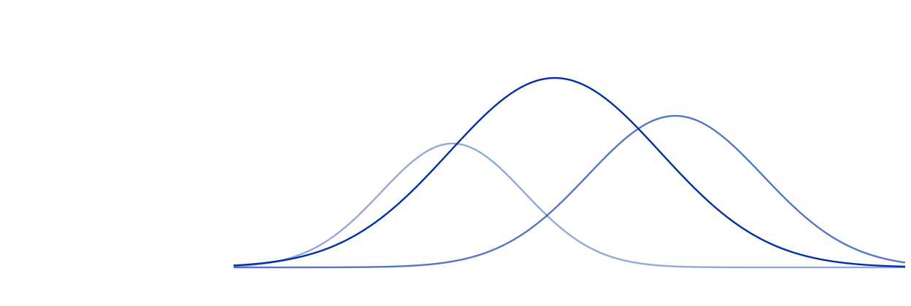

```{=html}
<section class="course-intro" aria-labelledby="course-title">
  <div class="course-background" aria-hidden="true"></div>
  <div class="intro-copy">
    <h1 id="course-title">Data Analysis<br>in R</h1>
    <p class="course-description">A hands-on workshop in six parts for beginner to intermediate R users. You start with your first line of code, learn to plot, transform, and tidy data, set up an RStudio project, and finish with a complete analysis of a real dataset.</p>
    <p class="workshop-lead">Workshop developed and led by <strong>Asst. Prof. Jan Gačnik</strong>.</p>
    <a class="btn btn-primary" href="materials.html">View workshop materials</a>
  </div>
  <div class="course-preparation" role="complementary" aria-labelledby="preparation-title">
    <h2 id="preparation-title">Prepare for the workshop</h2>
    <p>Install R, RStudio, and the three required packages, then test the starter project.</p>
    <p><a href="setup.html">Open the setup guide</a></p>
    <a href="downloads/example_project.zip" download>Download starter project</a>
  </div>
</section>

<section class="course-syllabus" aria-labelledby="syllabus-title">
  <div class="syllabus-heading"><h2 id="syllabus-title">What you will learn</h2></div>
  <ol class="lesson-list">
    <li><div class="lesson-copy"><h3><a href="R_part1.html">1. Introduction to R</a></h3><p>Understand why R is useful, meet RStudio, work with objects and functions, and learn how packages extend R.</p></div>
      <a class="lesson-action" href="R_part1.html" aria-label="Open Part 1: Introduction to R">Open slides</a></li>
    <li><div class="lesson-copy"><h3><a href="R_part2.html">2. Data visualization</a></h3><p>Build graphics layer by layer with <code>ggplot2</code>, including labels, themes, and faceting.</p></div>
      <a class="lesson-action" href="R_part2.html" aria-label="Open Part 2: Data visualization">Open slides</a></li>
    <li><div class="lesson-copy"><h3><a href="R_part3.html">3. Data transformation</a></h3><p>Filter, mutate, group, and summarize data with <code>dplyr</code>.</p></div>
      <a class="lesson-action" href="R_part3.html" aria-label="Open Part 3: Data transformation">Open slides</a></li>
    <li><div class="lesson-copy"><h3><a href="R_part4.html">4. Data tidying</a></h3><p>Recognize tidy data and reshape tables between long and wide formats.</p></div>
      <a class="lesson-action" href="R_part4.html" aria-label="Open Part 4: Data tidying">Open slides</a></li>
    <li><div class="lesson-copy"><h3><a href="R_part5.html">5. Projects and data import</a></h3><p>Use relative paths, organize an RStudio project, and import a CSV file.</p></div>
      <a class="lesson-action" href="R_part5.html" aria-label="Open Part 5: Projects and data import">Open slides</a></li>
    <li><div class="lesson-copy"><h3><a href="R_part6.html">6. Complete project demonstration</a></h3><p>Follow one analysis of a real dataset from import to a simple model and saved outputs.</p></div>
      <a class="lesson-action" href="R_part6.html" aria-label="Open Part 6: Complete project demonstration">Open slides</a></li>
  </ol>
</section>
```

::: {.course-usage}
## How to use these materials

::: {.use-grid}
::: {.use-item}
### Before

Complete the [setup guide](setup.qmd). If possible, do this a day before the workshop so there is time to resolve installation problems.
:::

::: {.use-item}
### During

Keep the interactive slides open in your browser and use RStudio for the hands-on exercises. Code examples marked as interactive can also run directly in the browser.
:::

::: {.use-item}
### After

Use the PDFs for quick reference and return to the interactive slides whenever you want to rerun an example. The complete source remains available in the [GitHub repository](https://github.com/jgacnik/r-data-workshop).
:::
:::
:::
